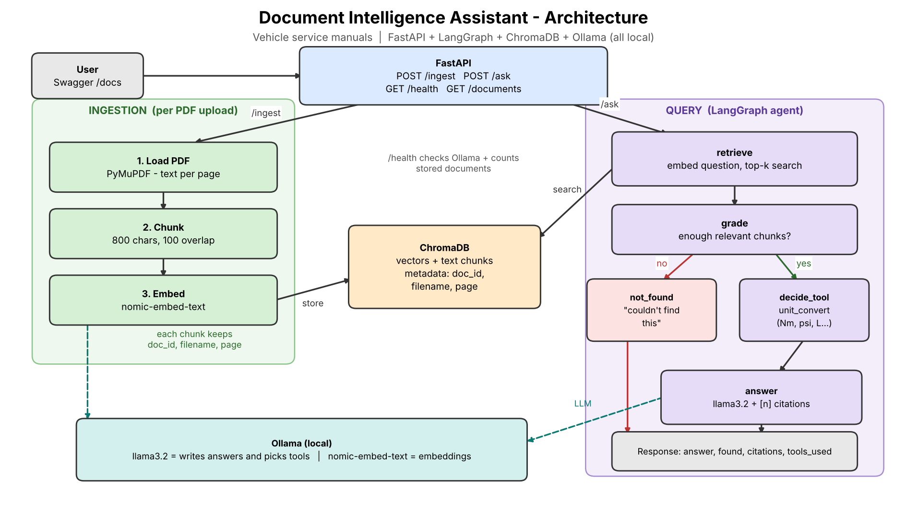

# Document Intelligence Assistant

Upload PDFs (vehicle service manuals), ask questions, get a streamed answer with page citations.
Everything runs locally on Ollama. A LangGraph agent retrieves from ChromaDB, uses a unit-converter
tool when needed, and says "couldn't find this" instead of guessing.



## Routes
`POST /ingest` - `POST /ask` (streamed) - `POST /ask/sync` - `GET /health` - `GET /documents` - `DELETE /documents/{doc_id}`  
Details: `docs/api_routes.md`

## Run it (Windows PowerShell; Mac/Linux commands in brackets)
```powershell
ollama pull llama3.2
ollama pull nomic-embed-text
python -m venv .venv
.venv\Scripts\Activate.ps1          # [source .venv/bin/activate]
pip install -r requirements.txt
copy .env.example .env              # [cp .env.example .env]
python -m scripts.ingest_pdfs       # ingest the 3 sample PDFs
uvicorn app.main:app --reload       # start the API -> http://127.0.0.1:8000/docs
```
Watch a streamed answer live (second terminal, venv active):
```powershell
python -m scripts.ask_cli "What engine oil grade does the Nomad T300 need?"
```
Tests and evals: `pytest` and `python -m evals.run_evals`
